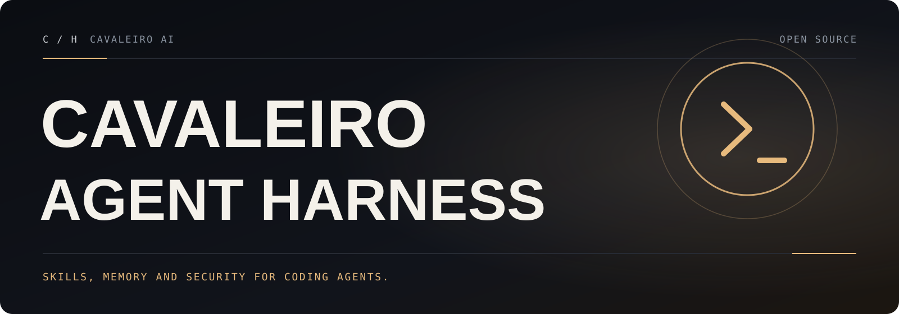

[English](README.md) · **Português (Brasil)**

<p align="center">
  
</p>

<p align="center">
  <a href="https://github.com/cavaleiro-ai/cavaleiro-agent-harness/actions/workflows/ci.yml"></a>
  <a href="LICENSE"></a>
  <a href="CHANGELOG.md"></a>
</p>

> [!NOTE]
> **O Cavaleiro Agent Harness** é mantido pela [Cavaleiro AI](https://github.com/cavaleiro-ai). Ele reúne skills, agentes, hooks, regras e instaladores para agentes de código, com correções verificadas na mesclagem de configurações e na segurança dos hooks ([o que ele adiciona](#o-que-o-cavaleiro-agent-harness-adiciona)). Os identificadores de pacote, comando, plugin e skill mantêm o nome `ecc`, por isso você verá `ecc` nos comandos; veja [Compatibilidade](#compatibilidade).

# Cavaleiro Agent Harness

Seu agente já sabe escrever código. O Cavaleiro Agent Harness dá a ele um sistema de engenharia coordenado: planejar antes de construir, verificar mudanças com testes, revisar o próprio trabalho em um contexto limpo, lembrar o que importa e transformar acertos repetidos em skills e fluxos reutilizáveis.

```text
planejar -> testar -> implementar -> revisar -> verificar -> lembrar -> melhorar
```

Em vez de reconstruir esse processo em cada prompt, você instala uma vez e ele passa a fazer parte de como o agente trabalha.

Funciona melhor com o **Claude Code**, tem caminhos de plugin nativo para **Codex** e **Qoder**, e adaptadores com capacidades limitadas para Cursor, OpenCode, Gemini, Zed, GitHub Copilot, Antigravity, Qwen, Hermes, OpenClaw, Kimi, CodeBuddy e JoyCode. Consulte o [suporte por plataforma](#suporte-por-plataforma) antes de supor paridade de recursos.

| Incluído | Quantidade (1.0.0) | O que entrega |
| --- | ---: | --- |
| Agentes | 71 | Planejamento, revisão, correção de build, segurança, arquitetura e domínios específicos |
| Skills | 311 | TDD, pesquisa, segurança, documentação, frontend, dados, ML, operações e mais |
| Comandos | 97 | Atalhos de conveniência enquanto o projeto migra para uma superfície centrada em skills |
| Hooks e memória | Runtime | Bloqueios de segurança, resumos de sessão, aprendizado contínuo, instintos e controle de contexto |
| Regras | Seletivas | Padrões sempre carregados, escolhidos por linguagem ou projeto |

## O que o Cavaleiro Agent Harness adiciona

Tudo do motor 2.2.3 do projeto original e mais as correções abaixo. Cada uma tem um teste de regressão que falha no código original e passa aqui ([lista completa no changelog](CHANGELOG.md#cavaleiro-agent-harness-100--2026-10-17)):

- **A mesclagem de configuração do Codex nunca grava um arquivo que o Codex não consiga carregar.** `merge-codex-config.js` e `merge-mcp-config.js` agora leem o TOML entendendo strings, respeitam as regras de chaves pontuadas e tabelas inline do TOML 1.0, preservam comentários que pertencem à tabela seguinte, aceitam o BOM UTF-8 que o Windows PowerShell 5.1 grava e validam o resultado (inclusive se todos os valores existentes continuam iguais) antes de gravar.
- **Fim das tabelas `[mcp_servers.*]` duplicadas.** Uma tabela de servidor existente sem `command` (por exemplo só `enabled = false`) é tratada como presente; definições inline ou com aspas são deixadas como estão em vez de duplicadas.
- **A verificação de saúde de MCP funciona em sessões reais do Claude Code.** O hook lê `hook_event_name` do payload em stdin, então o disjuntor de `PostToolUseFailure` passa a registrar falhas, e um argumento `server` da própria ferramenta MCP não consegue mais redirecionar nem burlar a verificação.
- **A ferramenta PowerShell não consegue mais pular os git hooks.** `git commit --no-verify`, `-n` e mudanças de `core.hooksPath` são bloqueados no PowerShell exatamente como no Bash.
- **Menos bloqueios falsos e menos brechas.** A verificação estrita de commit acusa instruções `debugger` reais, e não a palavra em comentários ou strings; a proteção de configuração também cobre apelidos do NTFS como `.eslintrc.js::$DATA` e `.eslintrc.js.`; a captura de governança rotula corretamente eventos PreToolUse; `ecc/setup.json` salvo com BOM volta a ser respeitado (issue original #3623); a auditoria `docs-governance` não quebra mais no Windows quando a saída é capturada.
- **Repositório seguro para fork.** Workflows que publicam, assinam ou anunciam ficam em [`.github/workflows-disabled/`](.github/workflows-disabled/README.md); CI, lint e varreduras de segurança continuam rodando.
- **Documentação em português:** este README e o [guia completo em português](docs/cavaleiro/GUIA-PT-BR.md), além de um [relatório de engenharia](docs/cavaleiro/ENGINEERING.md) (em inglês) com linha de base, achados e evidências.

## Compatibilidade

O Cavaleiro Agent Harness renomeia o **projeto**, não os **identificadores** dos quais suas ferramentas e configurações dependem:

| Identificador | Valor (inalterado) |
| --- | --- |
| Nome do pacote npm | `ecc-universal` |
| Comandos de CLI | `ecc`, `ecc-install`, `ecc-universal`, `ecc-control-pane`, `ecc-memory-mcp`, `ecc-plan-canvas` |
| ID de plugin e marketplace (Claude Code, Codex, Qoder) | `ecc@ecc` (marketplace `ecc`) |
| IDs de skills, agentes, comandos e hooks | inalterados (por exemplo `/ecc:configure-ecc`, `pre:bash:block-no-verify`) |
| Variáveis de ambiente | `ECC_*`, `CLAUDE_*`, `CODEX_HOME`, ... |
| Arquivos e pastas de configuração | `~/.claude/`, `~/.codex/config.toml`, `.cursor/`, `.kimi-code/`, `hooks/hooks.json`, ... |

Duas consequências importantes:

- **`npx ecc-universal@2.2.3 ...` instala o projeto original, não este repositório.** O Cavaleiro Agent Harness não publica no npm. Para ter as correções do Cavaleiro, clone este repositório e rode os mesmos comandos a partir dele: `node scripts/ecc.js setup`, `node scripts/ecc.js install ...`, `./install.sh ...` ou `.\install.ps1 ...`. Onde a documentação mostrar `npx ecc-universal@2.2.3 <comando>`, o equivalente no clone é `node scripts/ecc.js <comando>`.
- **Algumas superfícies em tempo de execução ainda apontam para a infraestrutura original.** O setup guiado do plugin do Claude registra o marketplace `ecc` a partir do GitHub original, e `ecc feedback`, o banner de boas-vindas e os links do AgentShield se referem ao projeto original. O harness não envia diagnósticos nem telemetria automaticamente. Para carregar o plugin deste repositório, registre a URL deste repositório como marketplace (veja [Claude Code](#claude-code)).

Uma tradução mais antiga do README completo continua disponível em [docs/pt-BR/README.md](docs/pt-BR/README.md).

## Instalação

> [!IMPORTANT]
> Requisitos: **Node.js 18 ou mais recente** e **Git**. O setup do plugin do Claude também exige o **Claude Code 2.1** ou mais recente no `PATH`. Escolha **um** método de instalação por harness: instalar duas vezes no mesmo harness duplica skills, comandos, hooks ou configuração.

### Opção recomendada: a partir do clone (inclui as correções do Cavaleiro)

```bash
git clone https://github.com/cavaleiro-ai/cavaleiro-agent-harness.git
cd cavaleiro-agent-harness
npm ci --ignore-scripts

# Assistente do plugin do Claude Code: escopo (usuário, projeto ou local) e perfil de hooks
node scripts/ecc.js setup

# Assistente multi-harness (Claude Code, Codex e Kimi Code na mesma confirmação)
node scripts/ecc.js install --guided
```

No Windows, use o PowerShell e os mesmos comandos `node scripts/ecc.js ...`. Para uma instalação gerenciada por perfil, use os wrappers:

```bash
./install.sh --profile minimal --target claude          # macOS / Linux / Git Bash
```

```powershell
.\install.ps1 --profile minimal --target claude         # Windows PowerShell
```

Para ver o que seria feito antes de gravar qualquer coisa, acrescente `--dry-run`:

```bash
node scripts/ecc.js install --guided --harness codex --dry-run
node scripts/ecc.js install --profile core --target kimi --dry-run
```

### Pelo pacote npm original

O pacote `ecc-universal` do npm é publicado pelo projeto original. Ele **não** contém as correções do Cavaleiro:

```bash
npx ecc-universal@2.2.3 setup
```

### Claude Code

Plugin nativo, dentro do Claude Code (instala skills, agentes, comandos e hooks do plugin a partir deste repositório):

```text
/plugin marketplace add https://github.com/cavaleiro-ai/cavaleiro-agent-harness
/plugin install ecc@ecc
```

Se escolher este caminho, pare aí: não rode também uma instalação manual completa (`--profile full`) no Claude Code. Plugins do Claude Code não distribuem `rules`; copie só os pacotes de regras que você usa:

```bash
mkdir -p ~/.claude/rules/ecc
cp -R rules/common ~/.claude/rules/ecc/
cp -R rules/typescript ~/.claude/rules/ecc/   # troque pela sua stack
```

Depois de instalado, `/ecc:configure-ecc` reconfigura o plugin dentro do Claude Code.

### Codex

Plugin nativo do Codex a partir deste repositório:

```bash
codex plugin marketplace add cavaleiro-ai/cavaleiro-agent-harness
codex plugin add ecc@ecc
codex plugin list --json
node scripts/codex/check-plugin-cache.js
```

O caminho legado `scripts/sync-ecc-to-codex.sh` copia e mescla configuração em `~/.codex`. Ele continua disponível por compatibilidade (rode o Codex uma vez antes para que `~/.codex/config.toml` exista) e, no Cavaleiro, nunca grava um `config.toml` inválido:

```bash
bash scripts/sync-ecc-to-codex.sh
node scripts/ecc.js uninstall --legacy-codex-sync --dry-run
```

Não use o sync legado junto com o plugin nativo do marketplace.

### Qoder

```bash
qoder plugins validate . --strict
qoder plugins install .
qoder plugins list
```

### Outros agentes e editores

| Harness | Instalação | Observações |
| --- | --- | --- |
| Cursor | `./install.sh --profile minimal --target cursor` | Adaptador local em `.cursor/` |
| OpenCode | `npm install && npm run build:opencode && ./install.sh --profile full --target opencode --enable-hooks` | Gera o payload do plugin antes da instalação completa |
| Gemini CLI | `./install.sh --profile minimal --target gemini` | Configuração local em `.gemini/` |
| Zed | `./install.sh --profile minimal --target zed` | Adaptador local em `.zed/` |
| Antigravity | `./install.sh --profile minimal --target antigravity` | Veja [ANTIGRAVITY-GUIDE](docs/ANTIGRAVITY-GUIDE.md) |
| Qwen CLI | `./install.sh --profile minimal --target qwen` | Veja [QWEN-GUIDE](docs/QWEN-GUIDE.md) |
| Hermes | `./install.sh --profile minimal --target hermes` | Veja [HERMES-SETUP](docs/HERMES-SETUP.md) |
| OpenClaw | `./install.sh --profile minimal --target openclaw` | Instalação gerenciada no diretório do usuário |
| Kimi Code CLI | `./install.sh --profile minimal --target kimi` | Instalação local em `.kimi-code/` |
| CodeBuddy | `./install.sh --profile minimal --target codebuddy` | Instalação local em `.codebuddy/` |
| JoyCode | `./install.sh --profile minimal --target joycode` | Instalação local em `.joycode/` |
| GitHub Copilot | `./install.sh --profile full --target copilot` | Skills em `.github/skills/` e agentes em `.github/agents/` |

No Windows, troque `./install.sh` por `.\install.ps1`. Para um harness sem alvo nativo, use o [guia de adaptação manual](docs/MANUAL-ADAPTATION-GUIDE.md).

### Redefinir ou desinstalar

```bash
node scripts/ecc.js list-installed       # o que está instalado e onde
node scripts/ecc.js doctor               # arquivos ausentes ou alterados
node scripts/ecc.js repair               # restaura arquivos gerenciados
node scripts/ecc.js uninstall --dry-run  # mostra o que seria removido
node scripts/ecc.js uninstall
```

A desinstalação remove apenas arquivos registrados no estado de instalação e preserva arquivos do usuário.

## Primeiros passos

Comece pelo fluxo de que você precisa, não pelo catálogo inteiro:

| O que você está fazendo | Comece por |
| --- | --- |
| Construindo uma funcionalidade | `/ecc:plan "descreva a funcionalidade"` e depois a skill `tdd-workflow` |
| Corrigindo um bug | Reproduza com um teste que falha e use `tdd-workflow` |
| Revisando código novo | `/code-review` para uma revisão em contexto limpo |
| Consertando um build | `/build-fix` |
| Limpando uma base de código | `/refactor-clean` |
| Verificando a pressão de contexto | `/context-budget` |
| Encerrando uma sessão longa | `/save-session` ou `/learn-eval` |
| Retomando depois | `/resume-session` |
| Auditando a configuração do agente | `/security-scan` |

Comandos do plugin usam a forma com namespace (`/ecc:plan "Adicionar autenticação"`); instalações manuais podem expor a forma curta (`/plan`). Exemplos práticos estão no [guia em português](docs/cavaleiro/GUIA-PT-BR.md#5-exemplos-práticos).

## Conceitos principais

- **Agentes** (`agents/`): subagentes especializados para delegar trabalho, como `planner`, `code-reviewer`, `tdd-guide`, `security-reviewer` e revisores por linguagem.
- **Skills** (`skills/`): definições de fluxo de trabalho e conhecimento de domínio (TDD, segurança, padrões de frameworks). São a superfície principal.
- **Comandos** (`commands/`): atalhos de barra que acionam skills e agentes.
- **Hooks** (`hooks/hooks.json`, `scripts/hooks/`): automações disparadas por eventos (antes e depois de cada ferramenta, início e fim de sessão, compactação). Os de bloqueio protegem git hooks, arquivos de configuração e comandos destrutivos; os consultivos falham abertos.
- **Regras** (`rules/`): diretrizes sempre carregadas (segurança, estilo, testes), separadas por linguagem.
- **Configurações MCP** (`mcp-configs/`): modelos de servidores MCP para integrações externas.

## Suporte por plataforma

O CLI Node.js e os instaladores gerenciados rodam em **Windows, macOS e Linux**. Alguns recursos opcionais (aprendizado contínuo, GAN, orquestração) ainda exigem Bash ou Python. No Windows nativo, recursos que dependem de shell exigem Git Bash ou WSL.

| Harness | Situação | Limitação importante |
| --- | --- | --- |
| Claude Code | Principal, estável | Use um perfil seletivo quando o tamanho do contexto importar |
| Codex | Plugin nativo suportado | Hooks nativos exigem decisão explícita de confiança; o sync legado é só compatibilidade |
| Qoder | Plugin nativo suportado | Apenas o hook `SessionStart` revisado é habilitado |
| Cursor, OpenCode, Copilot CLI | Beta | Paridade completa com o Claude não é garantida |
| Gemini, Zed, Antigravity, Qwen, Hermes, OpenClaw, Kimi, CodeBuddy, JoyCode | Experimental | A colocação de arquivos é testada; os recursos variam |

## Configuração

Variáveis de ambiente mais usadas:

```bash
export ECC_HOOK_PROFILE=standard                       # minimal, standard ou strict
export ECC_DISABLED_HOOKS="pre:bash:tmux-reminder"     # IDs de hooks separados por vírgula
export ECC_HOOKS_ENABLED=false                         # desliga todos os hooks
export ECC_SESSION_START_MAX_CHARS=4000                # limite de contexto no início da sessão
export ECC_DISABLED_MCPS=chrome-devtools               # servidores MCP que o sync do Codex não deve instalar
export CLAUDE_PACKAGE_MANAGER=pnpm                     # npm, pnpm, yarn ou bun
```

No PowerShell, use `$env:ECC_HOOK_PROFILE = 'standard'`. A configuração gerenciada dos hooks também pode ficar em `ecc/setup.json` (ou no caminho de `ECC_HOOK_CONFIG`); a partir desta versão, o arquivo pode ter BOM UTF-8. Detalhes e a lista completa estão no [guia em português](docs/cavaleiro/GUIA-PT-BR.md#6-configuração) e na [documentação dos hooks](hooks/README.md).

## Solução de problemas

Comece por `node scripts/ecc.js doctor` e `node scripts/ecc.js list-installed`. Problemas comuns (instalação duplicada, hooks que não carregam, Windows e PowerShell, sync do Codex) estão no [guia em português](docs/cavaleiro/GUIA-PT-BR.md#7-solução-de-problemas) e em [TROUBLESHOOTING.md](TROUBLESHOOTING.md).

## Testes

```bash
npm ci --ignore-scripts
npm test                                  # validadores + suíte completa
node tests/run-all.js hooks/              # só os testes cujo caminho contém "hooks/"
node tests/hooks/hooks.test.js            # um arquivo de teste
```

A suíte completa é grande (mais de 400 arquivos) e pode levar mais de uma hora no Windows.

## Contribuindo e segurança

Leia o [guia de contribuição](CONTRIBUTING.md) (em inglês) e o [Código de Conduta](CODE_OF_CONDUCT.md). Vulnerabilidades devem ser relatadas em privado, como descrito na [política de segurança](SECURITY.md): <https://github.com/cavaleiro-ai/cavaleiro-agent-harness/security/advisories/new>.

## Licença

Baseado no ECC · licença MIT · veja [LICENSE](LICENSE). Sem afiliação com o projeto original.
